<p align="center">
  
</p>

<h1 align="center">Multimodal Studio</h1>

<p align="center">
  <strong>Turn any document into a narrated, publish-ready video.</strong><br>
  Drop a chapter, notes, or a topic → pick who it is for → Gemini writes the slides, Gemini 3.8 Live speaks them, Cloud Run serves the app.
</p>

<p align="center">
  <a href="#how-to-use">How to use</a> ·
  <a href="#agentic-ai-architecture--flowchart">Agentic AI & Flowchart</a> ·
  <a href="#agent-harness-screenshots--dashboard">Harness UI</a> ·
  <a href="#real-world-scenarios--sample-artifacts">Scenarios & Samples</a> ·
  <a href="#what-it-can-do">What it can do</a> ·
  <a href="#run-it">Run it</a> ·
  <a href="#configure">Configure</a> ·
  <a href="#how-a-slide-fits-its-content">Slide layouts</a>
</p>

<p align="center">
  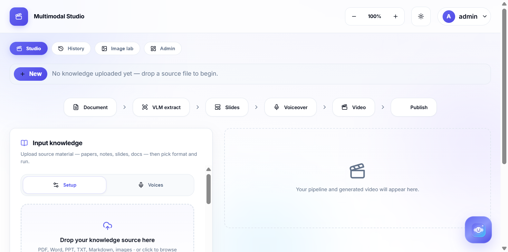
</p>
<p align="center"><sub>Studio: <strong>Studio · History · Image lab · Admin</strong>. Drop a source, pick a format, run Document → Extract → Slides → Voiceover → Video → Publish. Local runs sign in; the hosted demo link opens straight in.</sub></p>

## AI Builder Cup submission

**Team:** Multimodal Studio  
**Leader:** M Sai Teja (leads and built it)  
**Member:** Anil Kumar

**Pitch deck:** `Template/Out/Multimodal Studio - AI Builder Cup.pptx` (filled from the official template).

**What we built.** Multimodal Studio turns a chapter, notes, or a topic into a video a student can replay. Gemini 3.8 Flash (or Gemini 4 Argon) reads the source and writes the slides. Gemini 3.8 Live speaks them, with pauses instead of a flat read-aloud. The highlight walks with the sentence, which is the part that makes it feel like a person explaining.

**Who it is for.** A teacher who does not want to rebuild every PDF as slides. A tutor. A student revising. A parent walking through homework. The same path also fits a creator, but the first job is learning that is actually watchable.

**Live now.** GitHub: https://github.com/saitej123/Gemini-Multimodal-Studio · App: https://multimodal-studio-469528918286.us-central1.run.app (no login).

**What we want next.** A simpler Studio. Handwritten teaching templates. Manim-style motion for formulas. Predefined YouTuber looks and a custom one. Better animation models, both shipped and added by the teacher. New animation skills you can pick the way you pick a style today.

**How the required products are used.**

| Product | Role in this submission |
| --- | --- |
| **Gemini** | Text and vision on `gemini-3.8-flash` or `gemini-4-argon`. Speech on `gemini-3.8-live` (with `gemini-3.8-flash-tts` fallback). Live assistant on `gemini-3.8-live`. Thumbnails on Nano Banana. |
| **Cloud Run** | Hosts the FastAPI container. `deploy/cloudbuild.yaml` builds `Dockerfile` and deploys `multimodal-studio`. |
| **Firebase** | Hosting serves `pitch/` and can rewrite `/app` to the Cloud Run service (`firebase.json`). |
| **Firestore** | `FIRESTORE_ENABLED=true` mirrors each job snapshot into `studio_jobs` (`app/firestore_sync.py`). Browser writes are denied (`firestore.rules`). |

**Hosted demo link (no login).** `DEMO_PUBLIC=true` is set on Cloud Run. Reviewers land in Studio. Local runs keep invite-only sign-in.

**Public links** (keep these up through review). The demo video is the one item still to record: 3 to 4 minutes, one real file becoming an MP4.

| Required item | Rule | Where it comes from |
| --- | --- | --- |
| Pitch deck | Use the prescribed template | `Template/Out/Multimodal Studio - AI Builder Cup.pptx` |
| Demo video | 3 to 4 minutes, showing a real run | Record: sign in, drop a short PDF, pick Kore, run, play the MP4. Do not exceed 4:00. |
| Deployed prototype | Must stay up during judging | https://multimodal-studio-469528918286.us-central1.run.app |
| GitHub repository | Public source for the whole evaluation | https://github.com/saitej123/Gemini-Multimodal-Studio |

Set `GEMINI_API_KEY` on the Cloud Run service from Secret Manager. Do not commit `.env`.

---

## What it can do

<table>
  <tr>
    <td width="50%">
      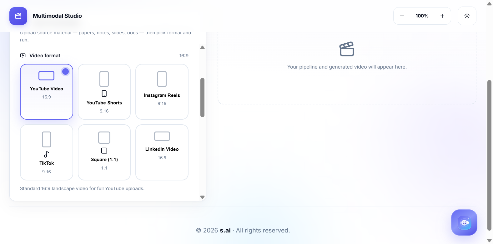
      <br><sub><strong>Six export formats</strong> — YouTube 16:9, Shorts, Reels, TikTok, Square 1:1, LinkedIn. Length chips follow the platform (8 min for long-form, seconds for Shorts).</sub>
    </td>
    <td width="50%">
      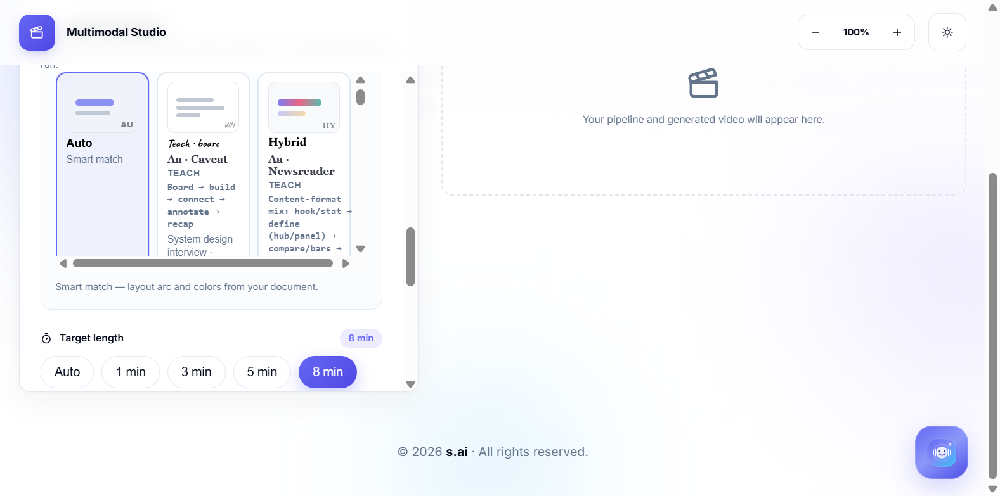
      <br><sub><strong>Visual styles</strong> — Teach, Motion, HyperFrames, Decks, Story, Data, Code. Auto picks layout + palette from the document.</sub>
    </td>
  </tr>
  <tr>
    <td>
      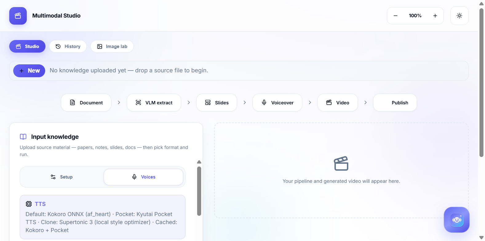
      <br><sub><strong>Narration</strong> — 30 Gemini studio voices. Preview, then the pipeline uses that voice.</sub>
    </td>
    <td>
      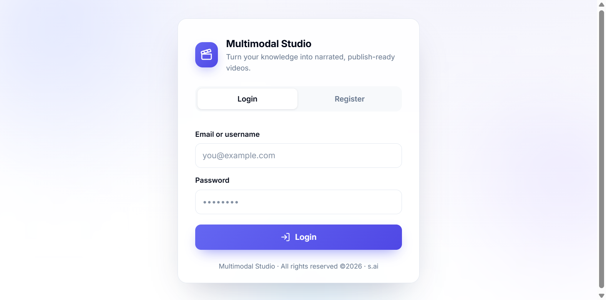
      <br><sub><strong>Access</strong> — invite-only sign-in on local runs; the hosted demo link opens straight in Studio (no login).</sub>
    </td>
  </tr>
</table>

| Capability | What you get |
| --- | --- |
| **Ingest** | PDF, Word, PowerPoint, TXT, Markdown, images — VLM reads pages (Gemini or local Gemma), with text fallback |
| **Teach to an audience** | Age group + knowledge level load a teaching prompt you can edit |
| **Plan long docs** | Split a book/paper into topics, research the web, then one video or many |
| **Review** | Duplicate-slide check and voice ↔ highlight sync before you ship |
| **Publish pack** | Titles, captions, tags, thumbnails for YouTube, Instagram, X, LinkedIn, TikTok, Substack, Medium |
| **Image lab** | Nano Banana Pro cloud thumbnails (Gemini) plus a prompt-based test generator |
| **C.H.I.T.T.I.** | In-app voice assistant (Gemini Live) while you work |
| **Admin** | Users, invites, color palette, layout-family preview, social credentials, cron papers, costs |
| **History** | Every generated session — reopen, re-run, or delete (fills after you run the pipeline) |
| **Automation** | Admin cron: trending papers (HF / arXiv / Semantic Scholar) → overnight videos |

<p align="center">
  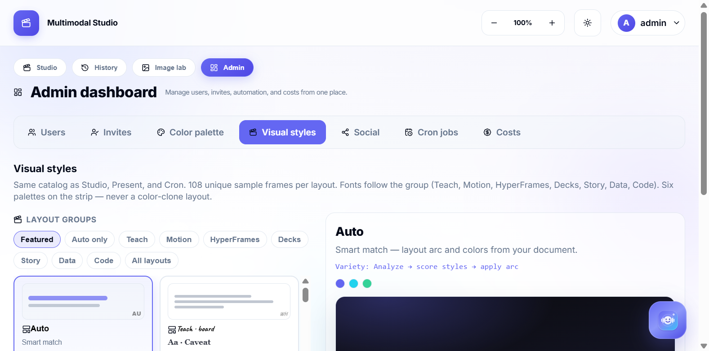
</p>
<p align="center"><sub>Admin: Users, Invites, Color palette, Visual styles (one frame per layout family), Social, Cron jobs, Costs.</sub></p>

<table>
  <tr>
    <td width="50%">
      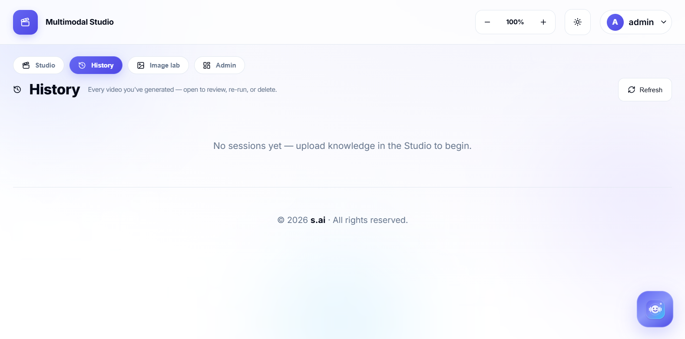
      <br><sub><strong>History</strong> — sessions appear here after a pipeline run. Open to review, re-run, or delete.</sub>
    </td>
    <td width="50%">
      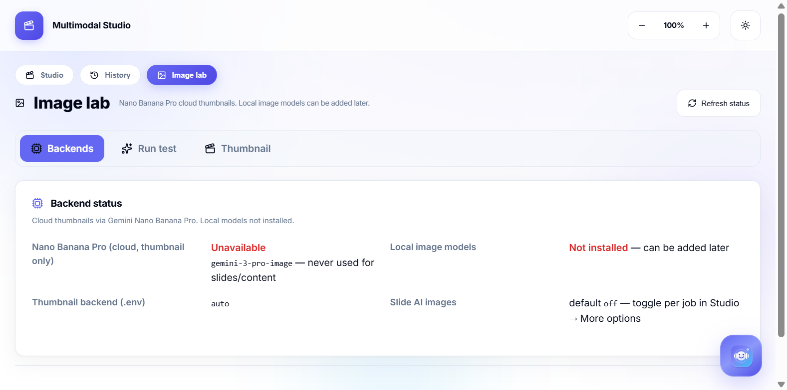
      <br><sub><strong>Image lab</strong> — Nano Banana Pro thumbnail backends and a prompt-based test generator.</sub>
    </td>
  </tr>
</table>

---

## Agentic AI Architecture & Flowchart

Multimodal Studio operates with a production **Agentic AI Harness** (`app/pipeline/agent_harness.py`) combining a bounded **ReAct Control Loop (Thought → Action → Observation → Self-Correction)**, an explicit **8-Tool Registry**, and a **Three-Tier Layered Memory Architecture** (`app/agent_memory.py`).

### System Flowchart

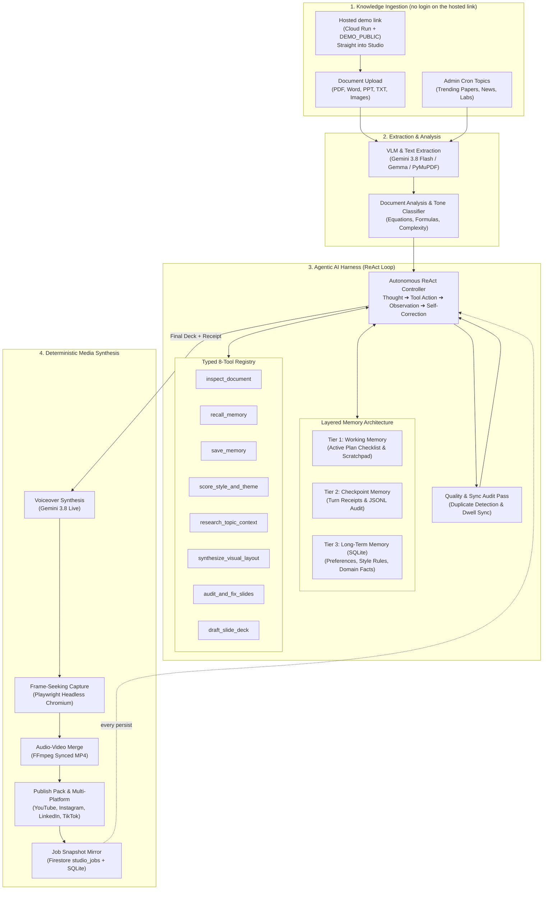

### Layered Memory & Tool Implementation

| Layer / Tool | Purpose & Engineering Standard |
| --- | --- |
| **Tier 1: Working Memory** | Ephemeral per-session state tracking the active goal, dynamic plan checklist (`[✓] inspect`, `[✓] recall`, `[✓] draft`), and observation buffer. |
| **Tier 2: Checkpoint Memory** | Episodic trace capturing every thought, tool name, argument payload, execution latency, and error state. Persisted to `agent_trace.jsonl`. |
| **Tier 3: Long-Term Memory** | SQLite database (`workspace/agent_memory.db`) with WAL mode storing persistent user preferences, document-to-style heuristics, and learned review feedback. |
| **Tool: `inspect_document`** | Deeply inspects document structure, volume, detected mathematical equations, and statistics. |
| **Tool: `recall_memory`** | Queries long-term memory via token and tag matching for audience rules and visual pacing. |
| **Tool: `save_memory`** | Persists run takeaways and user feedback into long-term memory for cross-session adaptation. |
| **Tool: `score_style_and_theme`** | Evaluates document tone against target audience to score layout styles and color palettes. |
| **Tool: `research_topic_context`** | Grounds concepts with live web research for verified facts and citations. |
| **Tool: `synthesize_visual_layout`** | Invokes `layout_engine` to compute data-fit cell coordinates and verify collision-free geometry. |
| **Tool: `audit_and_fix_slides`** | Deterministically reviews slides for duplicate headings, visual repetition, and voice-sync drift, triggering automated repair passes. |
| **Tool: `draft_slide_deck`** | Synthesizes structured slide deck JSON adhering to strict formatting constraints and word budgets. |

### Agent Harness Screenshots & Dashboard

<p align="center">
  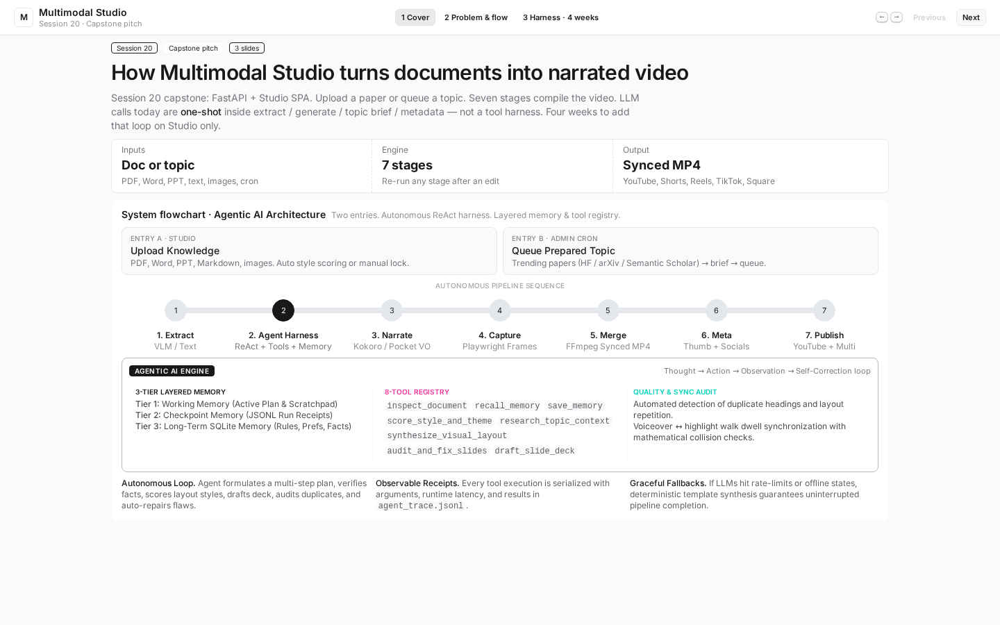
</p>
<p align="center"><sub><strong>Architecture Flowchart</strong> — Hosted demo or upload, then extract, slides, Gemini 3.8 Live, capture, and a Firestore copy of the job.</sub></p>

<table>
  <tr>
    <td width="50%">
      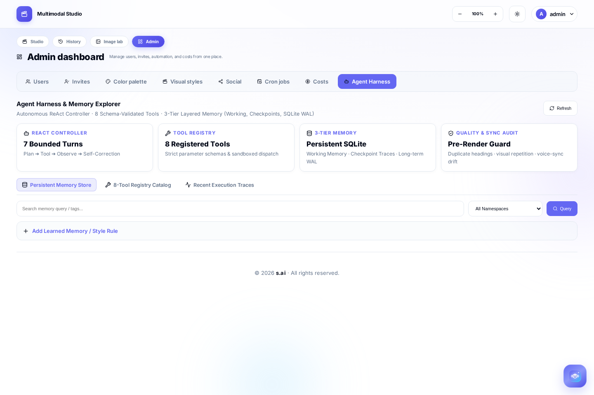
      <br><sub><strong>Agent Harness &amp; Memory Explorer</strong> — 4 architecture gauges, namespace filter, and live SQLite memory store with search.</sub>
    </td>
    <td width="50%">
      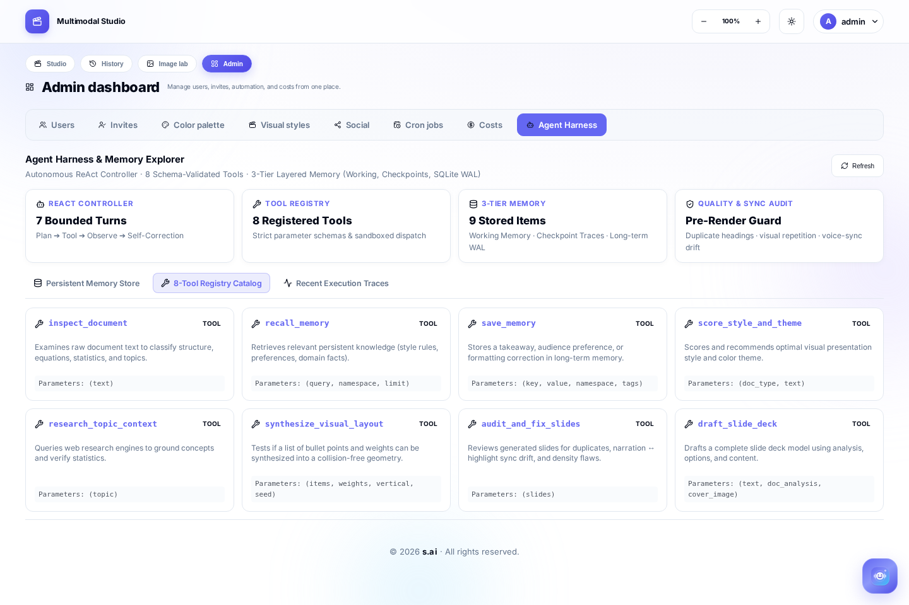
      <br><sub><strong>8-Tool Registry</strong> — Schema-validated domain tools with parameter typing and sandboxed dispatch.</sub>
    </td>
  </tr>
  <tr>
    <td colspan="2">
      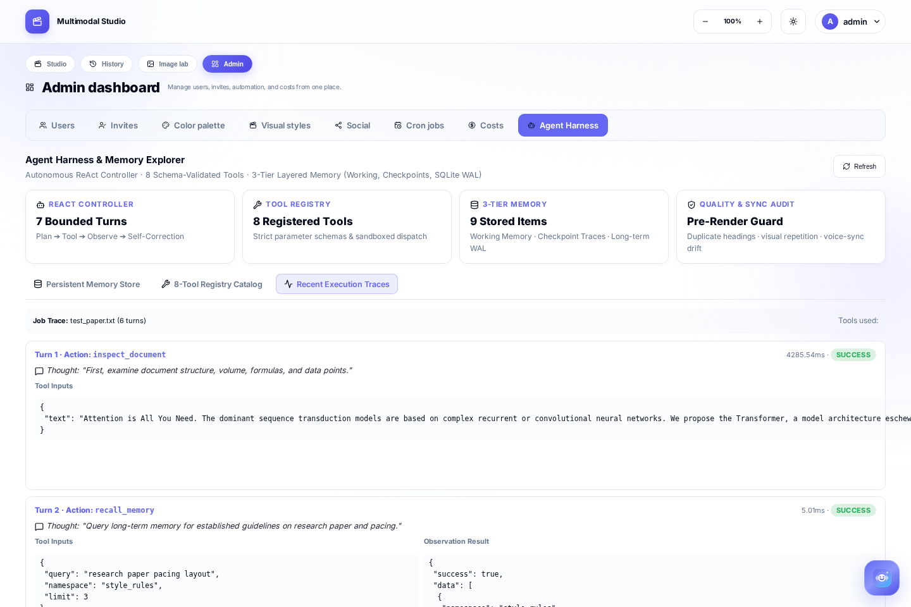
      <br><sub><strong>Turn-by-Turn ReAct Trace</strong> — Inspects document, recalls persistent rules, scores styles, drafts slides, and executes automated self-repair.</sub>
    </td>
  </tr>
</table>

### Real-World Scenarios & Sample Artifacts

#### Scenario 1: AI & Machine Learning Research Paper (ArXiv / HuggingFace)
* **Input Knowledge:** Research PDF on Transformer architecture with attention equations, projection matrices ($W_q, W_k, W_v$), and BLEU score benchmarks.
* **Agent Harness Loop:**
  1. `inspect_document`: Flags academic paper with LaTeX equations and benchmark comparisons.
  2. `recall_memory`: Pulls `style_rules:ml_paper` guideline: *Highlight mathematical formulas, benchmark stats, and core architecture components.*
  3. `score_style_and_theme`: Recommends `teardown` style with `cyber` theme (dark glass, cyan accent, KaTeX formula formatting).
  4. `draft_slide_deck`: Generates multi-beat explainer with embedded LaTeX formulas:
     $$\text{Attention}(Q, K, V) = \text{softmax}\left(\frac{QK^T}{\sqrt{d_k}}\right)V$$
  5. `audit_and_fix_slides`: Validates KaTeX syntax and confirms no duplicate headings.
  6. `save_memory`: Records session takeaways and citation tags to persistent memory.

```json
{
  "heading": "Scaled Dot-Product Attention",
  "layout": "bullets",
  "equations": ["\\text{Attention}(Q, K, V) = \\text{softmax}\\left(\\frac{QK^T}{\\sqrt{d_k}}\\right)V"],
  "bullets": [
    "Queries and keys of dimension d_k are multiplied",
    "Softmax assigns weights to all value vectors",
    "Multi-head projection runs h attention layers in parallel"
  ],
  "narration": "Rather than calculating a single attention pass, queries, keys, and values are linearly projected into lower-dimensional spaces, allowing the model to attend to information at different representation subspaces simultaneously."
}
```

#### Scenario 2: Strategic Executive Brief & Financial Metrics
* **Input Knowledge:** Executive quarterly review with ARR numbers, churn reduction, and strategic priorities.
* **Agent Harness Loop:**
  1. `inspect_document`: Identifies business memo with critical percentages and currency values.
  2. `recall_memory`: Pulls `style_rules:executive_summary`: *Lead with key business metrics and high-level decision pillars.*
  3. `score_style_and_theme`: Selects `minimal` style with `editorial` palette and weighted layout geometry.
  4. `synthesize_visual_layout`: Evaluates `weights: [100, 45, 30]` and builds a squarified treemap where retention dominates the visual field.

```json
{
  "heading": "Q3 Growth & Retention Drivers",
  "layout": "bullets",
  "weights": [100, 45, 30],
  "bullets": [
    "Enterprise net revenue retention reached 134%",
    "Self-serve customer acquisition cost dropped 22%",
    "Product-led onboarding reduced time-to-value to 4 days"
  ],
  "narration": "Our enterprise retention was the primary revenue engine this quarter, while self-serve acquisition efficiency gave us positive unit economics across all cohorts."
}
```

#### Scenario 3: Systems Engineering & Cloud Migration Walkthrough
* **Input Knowledge:** Engineering runbook detailing containerized microservice migration to Kubernetes.
* **Agent Harness Loop:**
  1. `inspect_document`: Recognizes technical documentation with step-by-step sequential dependencies.
  2. `recall_memory`: Fetches `style_rules:how_to_tutorial`: *Use ordered milestones with clear step numbers and actionable instructions.*
  3. `score_style_and_theme`: Assigns `blueprint` style with `path` / `cascade` layout geometry.
  4. `audit_and_fix_slides`: Verifies voiceover dwell time so complex technical steps match narration pacing without speech rushing.

```json
{
  "heading": "Zero-Downtime Cluster Migration",
  "layout": "steps",
  "steps": [
    "Provision multi-region control planes",
    "Mirror database traffic with dual writes",
    "Deploy blue-green ingress routing",
    "Cut over DNS and decommission legacy VMs"
  ],
  "narration": "We begin by provisioning independent control planes, mirror real-time database transactions, switch ingress traffic through blue-green proxies, and finalize DNS cutover with zero downtime."
}
```

---

## How to use

1. **Sign in** at `http://127.0.0.1:8001` (bootstrap admin is set in `.env`). Admins see the **Admin** tab (users, visual styles, cron, costs).
2. **Studio → drop a file** (or click the dropzone). PDF / Word / PPT / notes / images all work.
3. **Pick a video format** (YouTube, Shorts, Reels, TikTok, Square, LinkedIn) and a **target length**.
4. **Visual style** — leave **Auto**, or pick a layout family (Teach, Motion, HyperFrames, …) and a color palette.
5. **Audience** — age + knowledge, or leave Auto. Edit the teaching prompt if you want a custom tone.
6. **Voices** — preview a Gemini studio voice (default Kore). That voice narrates the whole video.
7. **Run pipeline**. Watch the strip: Document → VLM extract → Slides → Voiceover → Video → Publish.
8. **Review** generated slides for duplicates and voice sync. Tweak extracted text or narration and re-run a stage if needed.
9. **Publish details** — generate per-platform copy, then Post (if credentials are set) or Copy / Download.
10. **History** — every finished (or in-progress) job lands here so you can reopen it later.

**Tip:** for long PDFs, use **Plan topics** first, pick the chapters you want, then run one combined video or one video per topic.

---

## Run it

### Local

Python 3.12, FFmpeg on `PATH` (or the bundled `imageio-ffmpeg` fallback).

```bash
cp -n .env.example .env          # then set keys + admin login
bash scripts/setup_venv.sh       # uv venv + requirements.txt
source .venv/bin/activate
python run.py                    # http://127.0.0.1:8001
```

Open the URL, sign in with `AUTH_ADMIN_EMAIL` / `AUTH_ADMIN_USERNAME` + `AUTH_ADMIN_PASSWORD`.

### Docker

```bash
cp -n .env.example .env
docker compose up --build        # http://127.0.0.1:8001
```

GPU thumbnail image: `docker compose --profile gpu up --build`

---

## Configure

`.env` holds only the keys with real values (everything else uses built-in defaults). **Never commit `.env`.** On Cloud Run, set the same keys as service env vars / secrets instead.

| Setting | Purpose |
| --- | --- |
| `AUTH_ADMIN_EMAIL` / `USERNAME` / `PASSWORD` | Bootstrap admin (required) |
| `GEMINI_API_KEY` | Cloud LLM, vision extract, Nano Banana thumbnails |
| `GEMINI_MODEL` | Pinned to `gemini-3.8-flash` (or `gemini-4-argon`) |
| `GEMINI_TTS_MODEL` / `GEMINI_TTS_VOICE` | Expressive narration. Default `gemini-3.8-live` / `Kore` |
| `FIRESTORE_ENABLED` | Mirror job snapshots to Firestore (`studio_jobs`) |
| `DEMO_PUBLIC` | `true` on the hosted link: no login screen (local default keeps sign-in) |
| `YOUTUBE_CLIENT_SECRETS` | Path to OAuth client JSON for YouTube upload |
| `AUTO_ENABLED` | Nightly paper → video scheduler (admin) |

Social posting tokens live in `workspace/social_credentials.json` (admin UI), not in git.

---

## How a slide fits its content

The same notes do not get a recoloured copy of one card stack. Each slide is laid out from its own items — how many there are, how long each line is, and an optional importance score — so the geometry changes with the data. The visual style you pick (Teach, Motion, Decks, …) chooses the first layout family, the background motif, and the heading treatment. Two styles never share that combination.

| What you drop in | What you see |
| --- | --- |
| Four short takeaways | A treemap, an orbit, a stair, or a pinned-note scatter — whichever that style leads with, and a different one on the next slide |
| One idea much more important than the rest | That line gets the large cell; the others shrink around it |
| Three numbers (`98%`, `120ms`, `12,000 docs`) | Bar height or tile area follows the number, not a fixed three-column template |
| Ordered steps | A path, a cascade, or stacked bands, so reading order stays obvious |
| A slide with narration and no bullets | Short phrases are pulled from the narration and laid out the same way |
| A quote, diagram, or before/after | Those keep their own frame; the fitter does not restyle them |

Give a bullets slide a `weights` list (0–100, one score per bullet) when you want size to follow importance instead of sentence length:

```json
{
  "heading": "What actually moved retention",
  "layout": "bullets",
  "weights": [100, 40, 25],
  "bullets": [
    "Weekly review cut churn in half",
    "Onboarding email helped a little",
    "A redesigned logo did not"
  ],
  "narration": "The weekly review mattered most. The email helped. The logo did not."
}
```

Families the fitter can draw: treemap, orbit, cascade, masonry, path, golden split, bands, scatter, slices, skyline. A deck will not repeat a geometry, and it will not use the same family on two slides in a row.

Check it locally:

```bash
.venv/bin/python scripts/check_layout_engine.py
```

---

## Layout

```
app/            FastAPI, pipeline, auth, automation
frontend/       Studio SPA
pitch/          Capstone deck (also the Firebase Hosting public folder)
Template/      Official AI Builder Cup deck and the filled copy in Template/Out
deploy/        Cloud Run build (cloudbuild.yaml)
docker/         Container entrypoint
scripts/        setup_venv.sh, e2e
docs/screenshots/
.env.example    Template only — real secrets stay in .env
```

Runtime data is local and gitignored: `workspace/` (jobs + `sessions.db`), `models/` (TTS weights), `logs/`, `automation_output/`.

---

<p align="center">
  <sub>Multimodal Studio · AI Builder Cup · Anil Kumar · M Sai Teja</sub>
</p>
